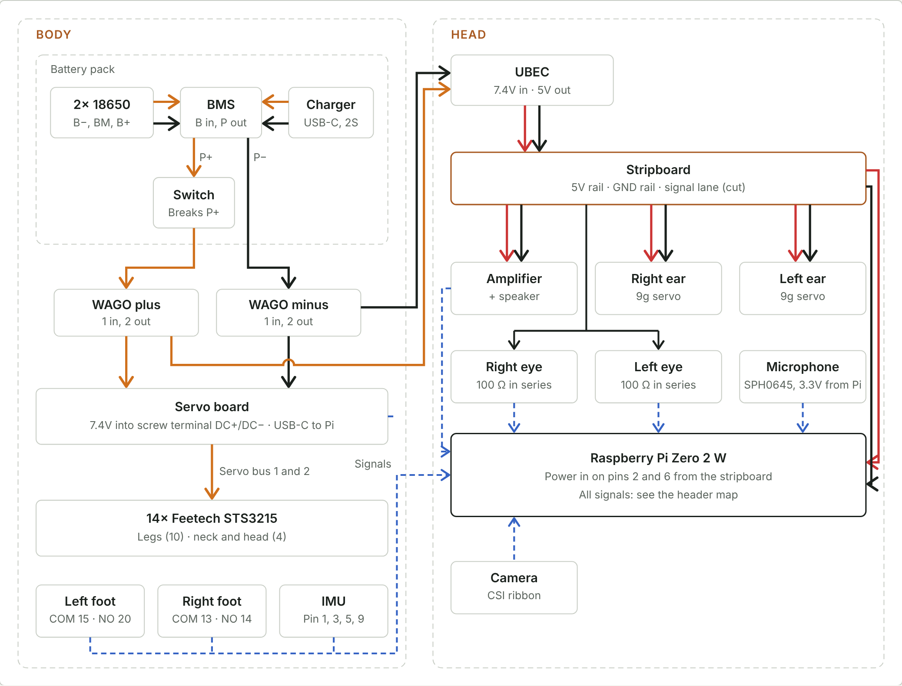
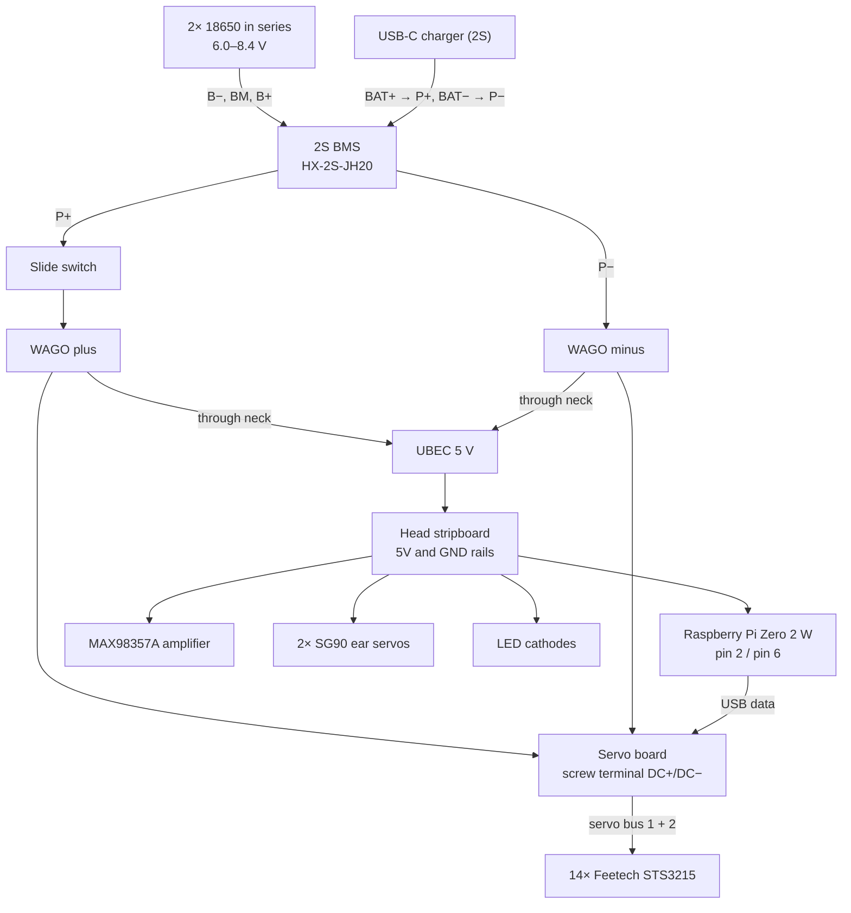

# System overview

## Power architecture

There are two rails:

| Rail | Source | Feeds |
|---|---|---|
| 7.4 V (switched) | Battery pack through the slide switch | Servo board (14 bus servos), UBEC |
| 5 V | UBEC in the head | Raspberry Pi, amplifier, ear servos |
| 3.3 V | Raspberry Pi pins 1 and 17 | IMU, microphone |

All grounds are common. The BMS protects on the negative side, so every minus wire downstream of the pack connects to **P−**, never to **B−**.

## Body and head

| Location | Parts |
|---|---|
| Body | Battery pack (cells, BMS, charger, switch), WAGO connectors, servo board, IMU, foot switches, leg servos |
| Head | UBEC, stripboard, Raspberry Pi, amplifier and speaker, microphone, eye LEDs, ear servos, camera |
| Through the neck | 7.4 V pair to the UBEC, USB cable Pi → servo board, IMU (4 wires), foot switches (4 wires), servo bus to neck/head servos |

See [03-power-distribution.md](03-power-distribution.md#removing-the-head) for making the head removable.
