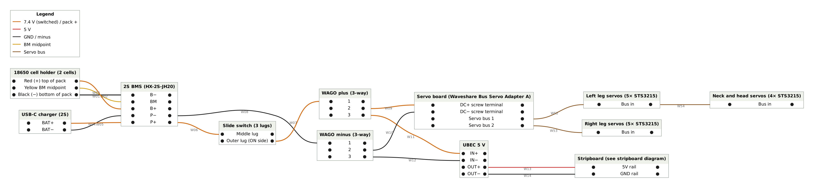

# Battery pack

Parts: 18650 cell holder (2 cells), 2× 18650 cells, 2S BMS (HX-2S-JH20), USB-C 2S charger board, 3-lug slide switch.

## How the BMS works

The HX-2S-JH20 has two groups of pads:

| Pad | Group | Connects to |
|---|---|---|
| B− | Battery | Cell 1 negative (bottom of the pack) |
| BM | Battery | Midpoint between the cells |
| B+ | Battery | Cell 2 positive (top of the pack) |
| P− | Protected output | Charger BAT−, WAGO minus |
| P+ | Protected output | Charger BAT+, slide switch |

The kit's board is marked "20A" and uses other pad labels than the names above:

| Name in this guide | Printed on the kit's board |
|---|---|
| B− | 0V (corner next to the MOSFETs) |
| BM | 4.2V (short edge) |
| B+ | 8.4V (corner, top) |
| P+ | ⊕ (middle pad next to the chip) |
| P− | ⊖ (middle pad next to the chip) |

Confirm with the continuity check below: 0V to ⊖ must read open.

The protection MOSFETs sit between **B−** and **P−**. They open on over-charge, over-discharge or over-current. That is why everything outside the pack, including the charger, connects to the **P** pads.

On boards of this type, B+ and P+ are usually the same copper. TNKR's drawings label one pad "B+/P+". **Unverified** for this exact board: the manufacturer's manual does not say. The wiring below is correct either way, because the cells go on B+ and the output on P+.

## Solder order

Order matters. Do not change it.

1. **Third lead on the holder.** Solder a yellow wire to the metal strip between the two cell positions. This is BM. Keep leads 8–10 cm. No cells in the holder yet.
2. **Tin everything.** Tin the BMS pads (B−, BM, B+, P−, P+) and all wire ends at about 350 °C. Work quickly: the pads are heavy copper.
3. **Continuity check.** Multimeter in continuity (beep) mode. A meter without a beeper (such as the DT830B) works on the 200 Ω range: near 0 Ω means connected, a lone "1" means open. **B− to P− must not beep.** If it does, the BMS is faulty. B+ to P+ probably beeps; the wiring does not depend on it.
4. **Cell wires to the BMS, in this order:** black to **B−**, then yellow to **BM**, then red to **B+**. Put the red wire on the **B+** pad, not P+. Never connect B+ before B−. With no cells in the holder this order has no electrical effect yet; it becomes the habit you repeat at cell insertion (see [Cells](#cells)).
5. **Charger to the BMS:** BAT− to **P−** first, then BAT+ to **P+**. Some boards print BAT as OUT. BAT− must reach P−, not B−, or the BMS cannot protect during charging.
6. **Switch:** the switch has three lugs. P+ to the **middle** lug. One **outer** lug to WAGO plus (see [03-power-distribution.md](03-power-distribution.md)). Leave the other outer lug empty. Never use both outer lugs. Heat-shrink every joint at the switch: the lugs are close together.
7. **P− to WAGO minus.**

After this, P+ carries two wires (charger BAT+, switch) and P− carries two wires (charger BAT−, WAGO minus).

## Two wires on one pad

Both wires belong on the pad: the pad is the connection point. Do not splice them somewhere else first; that only adds a joint.

1. Tin both wire ends separately.
2. If the pad has a plated hole, push the thick wire (18 AWG, to the switch or WAGO) through from below and solder it. Then solder the thin charger wire on top of the same pad.
3. If the pad has no hole, lay the two tinned ends side by side, twist them together, tin the twist and solder it onto the pad as one.
4. Check that the joint does not touch the neighbouring pad, and tug each wire gently.

The thick wire carries the robot's current. The charger wire carries 1–2 A at most.

## Wire gauge

| Wire | Gauge |
|---|---|
| Cell wires B−, B+ | 20 AWG |
| BM sense wire | 22 AWG |
| P+ → switch → WAGO, P− → WAGO | 18 AWG |
| Charger wires | 20 AWG |

Source: TNKR wiring table (step 52) for the cell, switch and WAGO wires. The charger wire gauge is this repo's choice.

## Cells

Charge both cells first. Their voltages must be within **0.05 V** of each other, or the BMS may shut off (TNKR step 7). Insert them following the holder's + and − marks: the bottom cell (between B− and BM) first, then the top cell (between BM and B+). A small spark on the second cell is normal: the BMS capacitors charge.

## Measurements

With cells inserted:

| Between | Expect |
|---|---|
| B− and B+ | 6.0–8.4 V |
| B− and BM | 3.0–4.2 V |
| BM and B+ | 3.0–4.2 V |
| P− and P+ | About the same as B− to B+ |

If P− to P+ reads 0 V, the BMS is asleep. Plug in the USB-C charger for a few seconds to wake it.

## Switch test

Measure across the switched output (the used outer lug to P−). One position reads 0 V, the other reads full pack voltage. Mark the ON side.

All 14 bus servos draw through this switch: several amps while walking, more in peaks. **Unverified:** the current rating of the kit's switch. If it gets warm or the robot browns out under load, replace it with a switch rated 5 A or more.

## Switch on plus or minus?

TNKR puts the switch on P+. The GitHub diagram puts it on P−. Both cut the power. This repo follows TNKR (P+), for two reasons:

- All grounds stay tied to the pack minus when the robot is off.
- With the switch on minus, a USB cable to a laptop (on the Pi or the servo board) gives the robot a ground path. The robot can then power up, or carry current, while it is switched "off".

If your pack is already built with the switch on minus: P+ goes straight to WAGO plus, and the switch output goes to WAGO minus. Unplug USB cables to other computers before you work on it.
