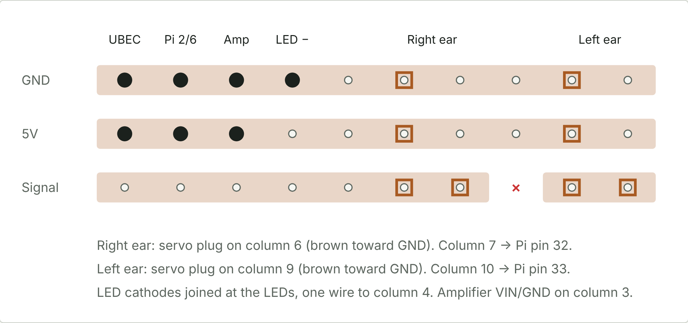

# Head wiring

The official guides run a 5 V wire and a GND wire across the head and splice up to six branches onto each. Every splice is a weak point and nothing can be removed without cutting. This build replaces the splices with a small stripboard.

## Stripboard

A piece of stripboard (copper strips, 2.54 mm pitch), 3 strips wide and 10 holes long.

| Strip | Use |
|---|---|
| Top | GND rail |
| Middle | 5 V rail |
| Bottom | Signal lane for the ear servos, cut between the two servos |

| Column | Part |
|---|---|
| 1 | UBEC output, soldered directly (red to 5 V, black to GND) |
| 2 | Wire pair to the Pi: 5 V → pin 2, GND → pin 6 |
| 3 | Amplifier VIN and GND |
| 4 | LED cathodes (one wire, see below) |
| 6 | Right ear servo: 3-pin header across all three strips |
| 7 | Right ear signal → Pi pin 32 |
| 8 | Signal strip cut here |
| 9 | Left ear servo: 3-pin header across all three strips |
| 10 | Left ear signal → Pi pin 33 |

### Building it

1. Score the board along a hole row with a craft knife, on both sides. Snap it over a table edge.
2. Cut the signal strip at hole 8: twist a 3–4 mm drill bit by hand until the copper is gone around the hole.
3. Solder the pin headers, then the UBEC wires.
4. Continuity check: 5 V to GND must not beep. Across the cut must not beep.
5. Power on with nothing plugged in. Measure 5.0 V ± 0.1 between the rails.
6. Mark the GND side. Servo plugs go on with the **brown** wire toward GND.
7. Mount with double-sided foam tape in the free area between the UBEC and the Pi.

## Ear servos (SG90)

Power comes from the stripboard (UBEC 5 V rail), not from the Pi. Signal comes from the Pi through the stripboard signal lane.

| Servo | Signal | Pin |
|---|---|---|
| Right ear | GPIO 12 | 32 |
| Left ear | GPIO 13 | 33 |

Source: `antennas.py` in the TNKR runtime. The code does not say whether left and right are from the duck's or your point of view. Swap the plugs if an ear moves on the wrong side.

## Eye LEDs

Two LEDs, **each through its own 100 Ω resistor** in series with the anode. A GPIO pin can only supply around 16 mA.

| LED | Anode via 100 Ω | Pin |
|---|---|---|
| Right eye | GPIO 23 | 16 |
| Left eye | GPIO 24 | 18 |

Join the two cathodes at the LEDs and run one wire to stripboard column 4 (GND). TNKR runs the cathode to Pi pin 14; the stripboard keeps the header pin free.

The runtime also supports a projector LED on GPIO 25 (pin 22). It is not in the kit.

## Amplifier and microphone (I2S)

MAX98357A amplifier and SPH0645 microphone share one I2S bus. The bit clock (BCLK) and word select (LRC/LRCL) go to both devices.

| Signal | Pi pin | Amplifier | Microphone |
|---|---|---|---|
| BCLK (GPIO 18) | 12 | BCLK | BCLK |
| LRC (GPIO 19) | 35 | LRC | LRCL |
| Data to amp (GPIO 21) | 40 | DIN | — |
| Data from mic (GPIO 20) | 38 | — | DOUT |
| Power | — | VIN from stripboard 5 V | 3V from Pi pin 17 |
| Ground | — | GND from stripboard | GND to Pi pin 39 |

**Shared clocks without double wires on the header:** run the Pi pin to the microphone pad, then solder a short wire from the same microphone pad onto the amplifier. Each Pi pin keeps one wire.

Connect power and ground before the signal lines. Leave the microphone's SEL pin open: that selects the left channel. Swapping the speaker's + and − only inverts phase.

TNKR powers the microphone from pin 1 and grounds it on pin 6. Pin 1 already feeds the IMU and pin 6 already carries the stripboard ground, so this build uses pins 17 and 39.

## Camera

CSI ribbon cable into the Pi's camera connector.
