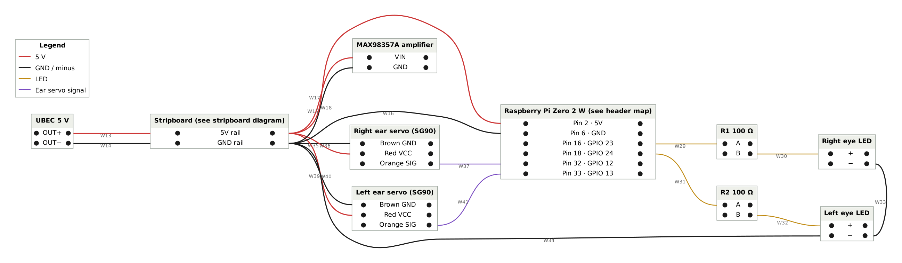
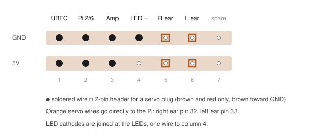

# Head wiring

The official guides run a 5 V wire and a GND wire across the head and splice up to six branches onto each. Every splice is a weak point and nothing can be removed without cutting. This build replaces the splices with a small stripboard.

## Stripboard

A piece of stripboard (copper strips, 2.54 mm pitch), 2 strips wide and 7 holes long. It carries power only; no signals pass through it.

| Strip | Use |
|---|---|
| Top | GND rail |
| Bottom | 5 V rail |

| Column | Part |
|---|---|
| 1 | UBEC output, soldered directly (red to 5 V, black to GND) |
| 2 | Wire pair to the Pi: 5 V → pin 2, GND → pin 6 |
| 3 | Amplifier VIN and GND |
| 4 | LED cathodes (one wire, see below) |
| 5 | Right ear servo: 2-pin header for brown (GND) and red (5 V) |
| 6 | Left ear servo: 2-pin header for brown (GND) and red (5 V) |
| 7 | Spare |

### Building it

1. Score the board along a hole row with a craft knife, on both sides. Snap it over a table edge.
2. Solder the pin headers, then the UBEC wires.
3. Continuity check: 5 V to GND must not beep.
4. Power on with nothing plugged in. Measure 5.0 V ± 0.1 between the rails.
5. Mark the GND side. Servo plugs go on with the **brown** wire toward GND.
6. Mount with double-sided foam tape in the free area between the UBEC and the Pi.

## Ear servos (SG90)

Power comes from the stripboard (UBEC 5 V rail), not from the Pi. The signal goes straight to the Pi with no joint in between.

The servo's plug holds all three wires in one housing. Split it:

1. Lift the plastic latch next to the orange wire with a needle and slide the terminal out.
2. Put heat-shrink over the bare terminal and push it directly onto the Pi pin.
3. Brown and red stay in the original housing, which plugs onto the stripboard header. Brown sits on GND, red on 5 V, and the empty cavity hangs off the 5 V edge of the board. Check with a meter before power-on: reversed, the servo gets reverse polarity.

No extra parts needed. If the orange wire does not reach the Pi, extend it with a male–female jumper.

| Servo | Signal | Pin |
|---|---|---|
| Right ear | GPIO 12 | 32 |
| Left ear | GPIO 13 | 33 |

Source: `antennas.py` in the TNKR runtime. The code does not say whether left and right are from the duck's or your point of view. If an ear moves on the wrong side, swap the two orange terminals on pins 32 and 33.

Software note: if you enable hardware PWM with `dtoverlay=pwm-2chan`, give it the pins (`pin=12,func=4,pin2=13,func2=4`). Without them the overlay takes GPIO 18/19 and breaks I2S audio.

## Eye LEDs

Two LEDs, **each through its own 100 Ω resistor** in series with the anode. A GPIO pin can only supply around 16 mA.

TNKR's step 51 drawing labels them 1 W flashlight LEDs. A white LED needs about 3.0–3.3 V, so on a 3.3 V pin through 100 Ω it gets only a few mA and glows dimly. That is expected and harmless. Brighter eyes need a transistor driver, which is outside this build.

| LED | Anode via 100 Ω | Pin |
|---|---|---|
| Right eye | GPIO 23 | 16 |
| Left eye | GPIO 24 | 18 |

Join the two cathodes at the LEDs and run one wire to stripboard column 4 (GND). TNKR runs the cathode to Pi pin 14; the stripboard keeps the header pin free. If an eye lights on the wrong side, swap the wires on pins 16 and 18.

The runtime also supports a projector LED on GPIO 25 (pin 22). It is not in the kit.

## Amplifier and microphone (I2S)

MAX98357A amplifier and SPH0645 microphone share one I2S bus. The bit clock (BCLK) and word select (LRC/LRCL) go to both devices.

| Signal | Pi pin | Amplifier | Microphone |
|---|---|---|---|
| BCLK (GPIO 18) | 12 | BCLK | BCLK |
| LRC (GPIO 19) | 35 | LRC | LRCL |
| Data to amp (GPIO 21) | 40 | DIN | — |
| Data from mic (GPIO 20) | 38 | — | DOUT |
| Power | — | VIN from stripboard 5 V | 3V from Pi pin 17 |
| Ground | — | GND from stripboard | GND to Pi pin 39 |

**Shared clocks without double wires on the header:** run the Pi pin to the microphone pad, then solder a short wire from the same microphone pad onto the amplifier. Each Pi pin keeps one wire.

Connect power and ground before the signal lines. Leave the microphone's SEL pin open: that selects the left channel. Swapping the speaker's + and − only inverts phase.

TNKR powers the microphone from pin 1 and grounds it on pin 6. Pin 1 already feeds the IMU and pin 6 already carries the stripboard ground, so this build uses pins 17 and 39.

## Camera

CSI ribbon cable into the Pi's camera connector.
