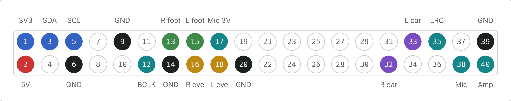
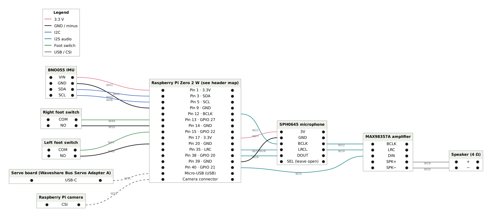

# Raspberry Pi header map

Viewed from above with the SD card on the left. Pin 1 is the square pad.

| Pin | Function | Wire from |
|---|---|---|
| 1 | 3.3 V | IMU VIN |
| 2 | 5 V | Stripboard 5 V rail |
| 3 | SDA (GPIO 2) | IMU SDA |
| 5 | SCL (GPIO 3) | IMU SCL |
| 6 | GND | Stripboard GND rail |
| 9 | GND | IMU GND |
| 12 | BCLK (GPIO 18) | Microphone BCLK, chained on to amplifier BCLK |
| 13 | GPIO 27 | Right foot switch, COM |
| 14 | GND | Right foot switch, NO |
| 15 | GPIO 22 | Left foot switch, COM |
| 16 | GPIO 23 | 100 Ω → right eye LED + |
| 17 | 3.3 V | Microphone 3V |
| 18 | GPIO 24 | 100 Ω → left eye LED + |
| 20 | GND | Left foot switch, NO |
| 32 | GPIO 12 (PWM) | Right ear servo, orange wire directly |
| 33 | GPIO 13 (PWM) | Left ear servo, orange wire directly |
| 35 | LRC (GPIO 19) | Microphone LRCL, chained on to amplifier LRC |
| 38 | GPIO 20 (I2S in) | Microphone DOUT |
| 39 | GND | Microphone GND |
| 40 | GPIO 21 (I2S out) | Amplifier DIN |

Free GND pins: 25, 30, 34. Free GPIO 25 (pin 22) is the optional projector LED.

## Verified against the code

Checked on 3 November 2026 against [tnkrai/Open_Duck_Mini_Runtime](https://github.com/tnkrai/Open_Duck_Mini_Runtime), `mini_bdx_runtime/mini_bdx_runtime/`:

| File | Constant | Value | Pin |
|---|---|---|---|
| `feet_contacts.py` | `LEFT_FOOT_PIN` | `board.D22` | 15 |
| `feet_contacts.py` | `RIGHT_FOOT_PIN` | `board.D27` | 13 |
| `eyes.py` | `LEFT_EYE_PIN` | `board.D24` | 18 |
| `eyes.py` | `RIGHT_EYE_PIN` | `board.D23` | 16 |
| `antennas.py` | `LEFT_ANTENNA_PIN` | `board.D13` | 33 |
| `antennas.py` | `RIGHT_ANTENNA_PIN` | `board.D12` | 32 |
| `projector.py` | `PROJECTOR_GPIO` | `board.D25` | 22 |

IMU on I2C (pins 3, 5) and I2S audio (pins 12, 35, 38, 40) use the Pi's fixed hardware functions.

## Foot switches

The switch closes when the foot touches the ground. COM goes to the GPIO, NO goes to GND. The runtime reads the pin with a pull-up.

TNKR connects both feet's NO terminals to pin 9 together with the IMU ground: three wires on one pin. This build uses pins 14 and 20.
